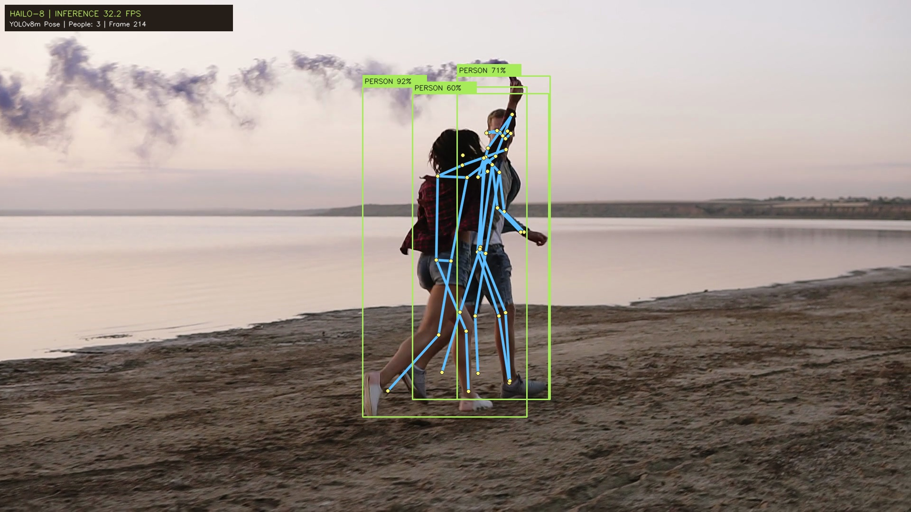
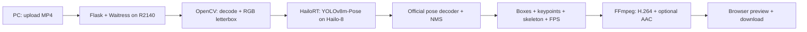

# Build an Edge AI App with Codex on reComputer R2140

**From a natural-language request to a working, hardware-accelerated pose estimation WebUI.**

[](LICENSE)


This hands-on project shows how to collaborate with **Codex to build and deploy an edge AI application**: describe the experience you want, inspect the actual board over SSH, reuse official vendor examples, and verify the result on physical hardware.

The example is **Pose Studio**: an English WebUI that accepts an MP4 from your computer and returns a video with human bounding boxes, 17 COCO body keypoints, skeleton connections, and measured inference FPS. Inference runs locally on a **reComputer AI R2140 with Hailo-8**. No training or model conversion is required.

> **Verified hardware:** this implementation runs on the Raspberry Pi 5-based R2140 with Hailo-8. It has not been validated on reComputer RK3576. The Codex collaboration process is reusable; inference backends and model formats must match the target hardware.

[中文：用 Codex 构建项目的完整过程](docs/CODEX_WORKFLOW.zh-CN.md) · [Validation report](docs/VALIDATION.md) · [Official Hailo examples](https://github.com/hailo-ai/hailo-apps)

## What you will learn

1. Turn a product idea into concrete requirements and constraints for Codex.
2. Inspect a remote board over SSH before making changes.
3. Reuse an installed accelerator runtime and official models/examples.
4. Build uploads, progress, video playback, and downloads around inference.
5. Test real hardware, diagnose failures, and distinguish inference FPS from application throughput.

## The application


- Upload an MP4 from your PC, up to 1 GiB.
- Adjust person and keypoint confidence thresholds.
- Run official precompiled **YOLOv8m-Pose** on **Hailo-8**.
- Draw human boxes, 17-keypoint poses, and skeleton connections.
- Watch progress, inference FPS, and overall processing FPS.
- Play/download H.264 MP4 output; retain optional audio as AAC.
- Reopen recent analyses, download metrics JSON, and delete old videos.

### Example output



| Sample | Purpose |
| --- | --- |
| [video/test.mp4](video/test.mp4) | Original test input: 1080p, 25 FPS, 9.32 seconds |
| [video/test-pose.mp4](video/test-pose.mp4) | Annotated output generated on the physical R2140 |

Download the MP4 files if GitHub does not play them inline.

## Build it with Codex

Give the board address and credentials through your local Codex session, not a public repository. The following prompts describe the workflow used to build this project.

### 1. Inspect before changing anything

```text
Connect to my reComputer AI R2140 via SSH using the connection details
I provide in this local session.
Check the OS, architecture, storage, Hailo-8 device, driver, HailoRT,
Python dependencies, and existing pose models. Verify remote commands.
Do not modify the system yet. Report missing application dependencies.
```

The inspection found working HailoRT, driver, and firmware **4.23.0**, plus NumPy and OpenCV. TAPPAS and Python GStreamer bindings were unavailable. The application therefore uses Hailo's **standalone Python inference and pose decoder**, without reinstalling the system stack.

### 2. Describe the result and boundaries

```text
Build and deploy a modern English YOLOv8 Pose Estimation WebUI.
Use Hailo-8 and an official precompiled YOLOv8m-Pose HEF compatible
with the installed HailoRT. Do not train or convert models.
Reference: https://github.com/hailo-ai/hailo-apps

Support MP4 upload from my PC, processing progress, playback, and download.
Draw human bounding boxes, the 17 COCO keypoints above the selected
confidence, and skeleton connections. Show measured inference FPS
separately from overall processing FPS.

Reuse installed dependencies and official examples. Keep new dependencies
in an app virtual environment. Do not reinstall drivers or change system
configuration without approval. Test on the physical board and fix errors.
```

### 3. Ask for evidence and iterate

```text
Upload video/test.mp4 through the app and process every frame on Hailo-8.
Inspect bounding boxes, keypoint alignment, and skeleton connections.
Verify output frame count, browser playback, seeking, download, and audio.
Test invalid-file recovery and a second inference run.
Report inference FPS and overall processing FPS separately.
Fix failures and rerun the checks affected by each fix.
```

Testing exposed a HailoRT callback keyword mismatch and audio muxing that shortened the video when audio ended first. Both were corrected and retested. Ask the agent for **observable validation on the device**, including inspection of the generated video.

## Run this repository

### Prerequisites

Use an R2140 with an existing functioning Hailo-8 installation. Verified versions:

| Component | Version |
| --- | --- |
| OS / architecture | Debian 13.6 / ARM64 |
| HailoRT, PCIe driver, firmware | 4.23.0 |
| Python | 3.13.5 |
| NumPy / OpenCV | 2.2.4 / 4.10.0 |
| App packages | Flask 3.1.3 / Waitress 3.0.2 |

`python3-venv`, Pillow, FFmpeg, and `ffprobe` must also be available. Check the device first:

```sh
hailortcli --version
hailortcli scan
hailortcli fw-control identify
```

### Clone, prepare, start

On the board:

```sh
git clone https://github.com/inteintegrity/codex-recomputer-r2140-pose.git
cd codex-recomputer-r2140-pose
sh setup.sh
sh start.sh
```

`setup.sh` checks prerequisites, creates `.venv` with access to existing system packages, installs the web layer, and downloads/verifies the official model. It does not install drivers or change system configuration. Missing prerequisites must be resolved for your device before proceeding.

Open **`http://<board-ip>:8080/`** from a PC on the same network, choose `video/test.mp4`, and click **Run pose estimation**.

```sh
sh stop.sh                   # Stop only this app
PORT=8081 sh start.sh         # Optional alternative port
tail -f app.log              # Inspect application logs
```

The process survives SSH disconnection. After a device reboot, run `sh start.sh` again; no automatic startup service is installed. The WebUI is intended for a trusted local network and has no account/login system.

### Workflow validation

With the server running:

```sh
sh validate_remote.sh
```

This checks invalid uploads, recovery, concurrent-job rejection, repeat inference, complete output frame retention, audio, seeking, and downloads. It creates test jobs under `data/` and writes `validation.json` locally.

## How it works



Neural-network inference runs on Hailo-8. CPU code handles video I/O, preprocessing, pose decoding/NMS, drawing, and encoding. The UI polls job progress and serves output with HTTP byte-range support.

**Inference FPS** measures completed HailoRT calls, including binding preparation, transfer, scheduling, and output retrieval. **Processing FPS** includes the full video pipeline. These differ from playback FPS; inference FPS is not a chip-only benchmark.

## Physical-device results

| Metric | Full sample run |
| --- | --- |
| Input / output | 1920 × 1080, 25 FPS, 233 frames |
| Duration | 9.32 seconds |
| Inference FPS | **32.2–32.4** |
| Overall processing FPS | **13.3–13.4** |
| Wall time | Approximately 17.5–17.7 seconds |
| Person detections / visible keypoints | 447 / 6,416 across one full run |
| Playback, seeking, downloads | Verified |

Throughput varies with resolution, scene complexity, and device activity. See [validation details](docs/VALIDATION.md).

## Official model and source attribution

The [official Hailo Apps repository](https://github.com/hailo-ai/hailo-apps) was inspected at commit `c61f843b618ea2faa20dad79097c0591900319f4`. Its configuration maps HailoRT 4.23.x to Model Zoo v2.18.0 and selects `yolov8m_pose` for Hailo-8 pose estimation.

- [Official precompiled Hailo-8 HEF](https://hailo-model-zoo.s3.eu-west-2.amazonaws.com/ModelZoo/Compiled/v2.18.0/hailo8/yolov8m_pose.hef)
- SHA-256: `54f22e23ee5e161e3b5d8507add82035122f72fa6357b453eb8773c63c0eb4b7`
- Input: RGB UINT8, 640 × 640; multi-scale outputs for boxes and 17 keypoints.
- `official_inference.py`: official standalone HailoRT inference wrapper.
- `official_pose_utils.py`: official pose decoder; only the logging import was adapted.

The HEF is downloaded at setup time rather than committed. No training, conversion, or compilation is performed.

## Repository layout

```text
app.py                      API, video jobs, inference, overlays, encoding
static/                     English WebUI
official_inference.py       Official Hailo inference wrapper
official_pose_utils.py      Official pose decoder
download_model.py           Official download + SHA-256 verification
setup.sh / start.sh / stop.sh
validate_remote.sh          Physical-device workflow checks
video/                      Input and annotated demonstration videos
docs/                       Screenshots, Chinese tutorial, validation
```

Limits: 1 GiB per upload; input up to 4096 × 2160 and 216,000 frames, subject to free disk space. Variable-frame-rate input is normalized to its reported source frame rate. Individual low-confidence joints are hidden according to the selected threshold.

## License

Application code and documentation: **[MIT](LICENSE)**. Reused Hailo code retains its [upstream MIT notice](HAILO-LICENSE). See [third-party notices](THIRD_PARTY_NOTICES.md) for model/runtime and sample-media attribution.
