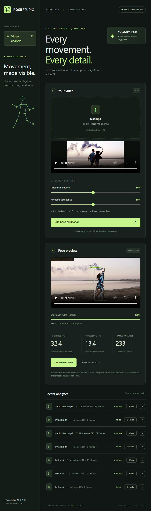

# 用 Codex 在 reComputer R2140 上构建 AI 应用

本项目展示如何把一个自然语言需求，交给 Codex 逐步变成能在开发板上运行、可以使用并经过实测的应用。

例子是人体姿态估计视频 WebUI：用户在 PC 上传 MP4，reComputer AI R2140 使用 Hailo-8 运行 YOLOv8m-Pose，输出带人体框、17 个 COCO 关键点、骨架连线和推理 FPS 的视频。

**实测平台是 Raspberry Pi 5 架构的 R2140 + Hailo-8，不是 RK3576。** 构建项目的方法可以复用；换开发板时需重新核对推理后端、模型格式和运行时兼容性。

## 1. 先检查环境

把 SSH 地址和认证信息提供给本地 Codex 会话，不要写进公共仓库。

```text
连接我的 reComputer AI R2140，检查系统、Hailo-8、HailoRT、
Python 依赖和已有模型，确认远程命令可执行。
暂时不要修改系统，先报告环境状态。
```

本次检查发现：HailoRT、驱动、固件均为 4.23.0，OpenCV 和 NumPy 可用，但没有完整的 TAPPAS 环境。Codex 因此选用官方 standalone HailoRT 示例，复用已有依赖。

## 2. 明确应用需求与操作边界

```text
帮我构建并部署 YOLOv8 Pose 视频 WebUI。使用 Hailo-8 推理，
从 Hailo 官方下载兼容的预编译 YOLOv8m-Pose HEF，不训练或转换模型。
参考 https://github.com/hailo-ai/hailo-apps。

界面使用英文，支持从 PC 上传 MP4、显示处理进度、播放和下载结果。
输出人体框、17 个 COCO 身体关键点、骨架连线和实际推理 FPS。
将推理 FPS 与包含视频处理的整体 FPS 分开显示。

尽量复用已有依赖和官方代码。新增依赖放在项目虚拟环境中。
未经允许不要重装驱动或修改系统配置。
必须在物理设备上测试完整流程，发现错误继续修复。
```

这样，Codex 能围绕完整的用户操作流程来构建应用，也知道哪些系统操作不在授权范围内。

## 3. 复用官方实现

本项目复用了 Hailo 的 Python 推理封装和姿态后处理代码，按官方版本映射选择 Model Zoo v2.18.0 的 Hailo-8 模型。

神经网络推理在 Hailo-8 上运行。CPU 完成视频解码、缩放补边、姿态解码、绘制和编码。WebUI 负责把这些能力组织成上传、运行、查看结果和下载的使用流程。

## 4. 用真实视频验收

```text
通过应用上传 video/test.mp4，实际处理所有帧。
检查人体框和骨架坐标、输出帧数、浏览器播放、拖动进度、下载和音频。
验证损坏文件恢复、忙碌时拒绝新任务，以及第二次推理。
修复问题后重新运行受影响的验证，提供实测 FPS。
```

本次测试发现并修复了两处问题：HailoRT 回调关键字参数不匹配，以及音频先结束时 FFmpeg 的 `-shortest` 截断最后两帧。只验证模型加载或 HTTP 200，无法证明整个应用可用。

## 实测结果

- 输入和输出：1920 × 1080，25 FPS，9.32 秒，233 帧。
- 推理调用实测：32.2–32.4 FPS。
- 整体处理吞吐：13.3–13.4 FPS。
- 验证完整上传、Hailo-8 推理、绘制、H.264 导出、浏览器播放和下载。
- 单独验证带音频片段，确认全部 52 帧与 AAC 音频保留。

推理 FPS 包含 HailoRT 调用、调度、传输和结果读取；整体 FPS 还包含 CPU 视频处理。两者都不等于播放帧率，也不能把前者称为芯片纯推理基准。

## 复现

在已经有 HailoRT 4.23.0、驱动和 FFmpeg 的 R2140 上运行：

```sh
git clone https://github.com/inteintegrity/codex-recomputer-r2140-pose.git
cd codex-recomputer-r2140-pose
sh setup.sh
sh start.sh
```

在同一局域网的 PC 打开 `http://<开发板IP>:8080/`。

`setup.sh` 只创建项目虚拟环境、安装 Web 依赖和下载模型，不安装驱动或修改系统配置。设备重启后需要重新执行 `sh start.sh`。



后续可以继续让 Codex 添加任务队列、动作分析或统计图表。每次迭代先明确验收条件，再在真实硬件上测试。
